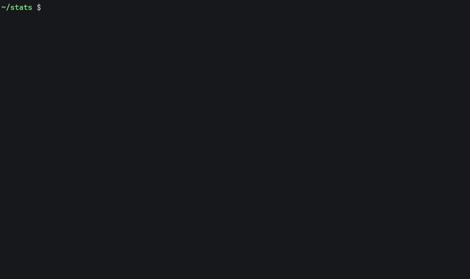

# dsh-romeo

[DeepSeek Harness](https://github.com/deepseek-ai/deepseek-harness) (dsh), DeepSeek's coding agent, on your computer, with DeepSeek-V4.1-Flash-1017 or Kimi-K3.1-Pro running on the GPUs of the [ROMEO](https://romeo.univ-reims.fr/) cluster: one command starts the model, opens the tunnel and opens dsh. Kimi can also run the agent while DeepSeek runs its subagents. The same model serves any other client: opencode, Codex, Claude Code, Aider, your editor.



The model is DeepSeek's 17 October 2026 release of V4.1-Flash, with its full 1M-token context, on 2 nodes (8 GH200, tensor parallel) with DSpark speculative decoding: about 200 tok/s for one agent and 2500 tok/s across 64 agents. Kimi-K3.1-Pro runs on 8 nodes (32 GH200): 38 tok/s for one agent, 29 each for 9. These are the settings an A/B study on ROMEO kept ([Tuning](docs/tuning.md)).

## Install

On your computer (macOS or Linux), with Node.js 20 or later (24.9+ gets dsh 0.2.2) and once `ssh romeo` logs you into ROMEO without a password (the `~/.ssh/config` entry is in [Usage](docs/usage.md#install)):

```bash
git clone https://github.com/wolf75222/dsh-romeo.git ~/dsh-romeo && ~/dsh-romeo/install.sh
```

Then run `dsh-romeo --launch` (in a new terminal if `install.sh` said `~/.local/bin` is not on your `PATH`). To update: `cd ~/dsh-romeo && git pull && ./install.sh`.

## Use

| Command | |
|---|---|
| `dsh-romeo --launch` | starts the model on ROMEO, waits until it answers (about 10 min), opens dsh in your browser |
| `dsh-romeo` | opens dsh on the model job already running |
| `dsh-romeo --status` | what runs on ROMEO, and why the last job ended |
| `dsh-romeo --estimate` | when everything would be running if you launched now (Slurm's estimate, nothing submitted) |
| `dsh-romeo --stop` | stops the model jobs: they use your project's GPU hours while they run |
| `dsh-romeo --doctor` | when something does not work: checks each piece and says what to type |
| `dsh-romeo --update` | installs the latest dsh-romeo (shows the changes, asks first); dsh-romeo also checks each time it starts and offers it (no by default) |

Options go before the command and are remembered for the next runs:

- `--models kimi`: Kimi-K3.1-Pro instead of DeepSeek (32 GH200; its weights are open to project r260105 only). `--models kimi+deepseek`: Kimi for the agent, DeepSeek for its subagents.
- `--voice on`: dsh's microphone button, transcribed by Whisper on ROMEO.
- `--web on`: web search in dsh, through RustXNG on the ROMEO login node (nothing to install on your computer).

Both models read images: paste a screenshot or attach a picture in dsh, nothing to turn on.

Other clients: `--desktop` (the [desktop app](https://github.com/deepseek-ai/deepseek-harness/releases), macOS), `headless "a task"` (for scripts), `--run opencode` (or `codex`, `claude`, `aider`...), `--serve` (only the endpoint, for an editor). `dsh-romeo --help` lists everything; [Usage](docs/usage.md) explains each command.

## Docs

[Usage](docs/usage.md) · [Other clients](docs/clients.md) · [Tuning](docs/tuning.md) · [How it works](docs/how-it-works.md) · [Troubleshooting](docs/troubleshooting.md) · [Changes](docs/changes.md) · [Development](docs/development.md)
